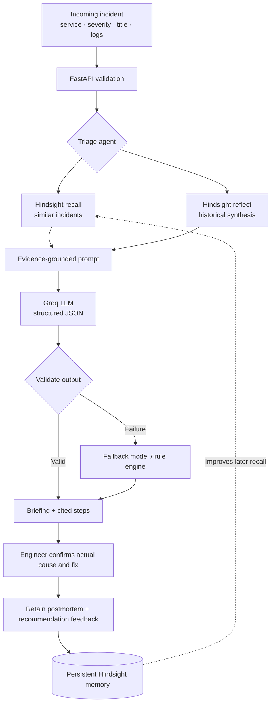
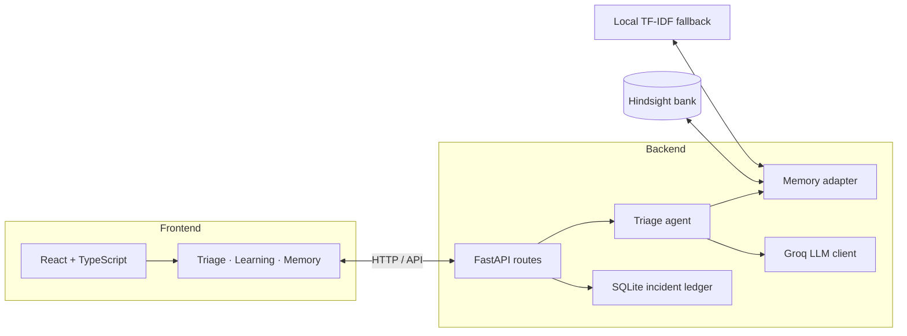

align="center">

♻️ Recur
An incident-response agent that learns from every outage.
Triage incidents. Recall what worked before. Capture the resolution. Make the next response smarter.

  
  
  
  
  
  

  <a href="#-live-demo-flow">Demo flow</a> ·
  <a href="#-how-it-works">How it works</a> ·
  <a href="#-memory-that-improves-over-time">Memory design</a> ·
  <a href="#-run-locally">Run locally</a> ·
  <a href="#-testing-and-evaluation">Testing</a>

🚨 The problem
An incident can look new while repeating a failure the team has already solved. The fix may be buried in old postmortems, chat threads, or engineer knowledge. A conventional alert classifier can categorize the symptoms, but it does not automatically learn from the team's previous resolutions.
Recur closes that loop. It retrieves related incident history, produces an evidence-linked triage briefing, and stores the engineer-confirmed root cause and fix. That experience can inform future incidents.
Built as an incident-response agent using Hindsight for persistent agent memory.

✨ What Recur demonstrates
Capability	What it does
Incident triage	Accepts a service, severity, title, and log context, then creates a structured incident briefing.
With/without-memory comparison	Runs a generic baseline beside a memory-grounded result so the value of retrieval is visible.
Evidence-linked suggestions	Connects recommended steps to recalled incidents, allowing an engineer to inspect the source.
Resolution feedback loop	Captures the actual root cause, successful fix, and outcome so future triage can learn from it.
Learning-curve replay	Replays a synthetic incident stream against a fresh memory bank and compares predictions over time.
Ask memory	Uses Hindsight reflection to answer questions about historical incident patterns.
Resilient execution	Supports an LLM path, model fallback, a rule-based engine, and a local offline memory path.

🎬 Live demo flow
The repository includes screenshots in docs/screenshots/ and a step-by-step demo in [`docs/DEMO_SCRIPT.md`](docs/DEMO_SCRIPT.md).
<table>
<tr>
<td width="50%" valign="top">

1. Incident briefing

Submit an incident and compare the response generated without memory to the response grounded in relevant historical incidents.
</td>
<td width="50%" valign="top">

2. Inspect memory

Browse retained incident experiences and explore what the agent has learned.
</td>
</tr>
<tr>
<td width="50%" valign="top">

3. Start with a clean slate

Seed the demo with historical synthetic postmortems to make the first recall run reproducible.
</td>
<td width="50%" valign="top">

4. Replay learning

Replay incidents and inspect how the memory-enabled path compares with the baseline.
</td>
</tr>
</table>

🧭 How it works

End-to-end request lifecycle
1. Receive: The frontend sends incident details to the FastAPI backend.
2. Retrieve: The memory layer searches for relevant previous incidents. The Hindsight path uses its recall operation; the local fallback uses TF-IDF-style lexical similarity with a service-entity boost.
3. Synthesize: Hindsight reflect creates a summary of historical patterns where available.
4. Reason: The agent supplies the incident and numbered memory evidence to the LLM, which is asked for a structured JSON response.
5. Validate: The backend checks the predicted root-cause category against a fixed taxonomy and validates the recommended steps and their memory references.
6. Compare: The UI presents the no-memory baseline and memory-grounded briefing side by side.
7. Close the loop: The engineer records the confirmed root cause and fix. Recur retains the postmortem and feedback so later incidents can use that experience.
🧠 Memory that improves over time
Hindsight is not just a chat-history store in this design. It is the persistent incident-memory layer.
Hindsight operation	How Recur uses it
create_bank	Creates a bank with an on-call mission and a skeptical disposition, encouraging reflection to prioritize confirmed evidence.
retain	Stores dated postmortems and recommendation feedback, using incident IDs as document IDs where supported.
recall	Retrieves similar incidents for triage and memory search. The returned memories become evidence for the agent.
reflect	Summarizes recurring causes for briefings and answers natural-language questions in the Memory view.
list_memories	Powers the interface for browsing stored experiences.

Each resolved incident can contribute two kinds of experience:
- Incident postmortem: observed symptoms, root-cause category, confirmed cause, working fix, and resolution time.
- Recommendation feedback: what Recur recommended and whether the engineer confirmed or rejected that recommendation.
This separates what happened from whether the agent's suggestion was useful.
Implementation notes: [`docs/HINDSIGHT_USAGE.md`](docs/HINDSIGHT_USAGE.md).
🏗️ Architecture and technology

Layer	Technology	Responsibility
Frontend	React, TypeScript, Vite, CSS	Triage, briefing comparison, learning replay, memory search, and resolution workflows.
API	Python, FastAPI, Pydantic	Request validation, API endpoints, orchestration, and response schemas.
Agent	Python	Recall/reflect/reason workflow, taxonomy validation, baseline comparison, and rule-based fallback.
LLM	Groq API via httpx	Structured incident reasoning with primary/fallback model configuration.
Long-term memory	Hindsight client	Retention, semantic recall, reflection, and memory browsing.
Local persistence	SQLite	Incident ledger, briefings, resolutions, and local fallback memory.
Packaging	Docker, Docker Compose	Containerized backend/frontend and optional self-hosted Hindsight profile.
Quality	pytest, TypeScript compiler, Vite build, GitHub Actions	Automated backend checks and frontend type/build validation.

Repository map
recur/
├── backend/
│   ├── app/
│   │   ├── main.py          # FastAPI routes and application wiring
│   │   ├── agent.py         # Triage, reasoning, validation, and fallback
│   │   ├── memory.py        # Hindsight and local memory adapters
│   │   ├── llm.py           # Groq client, retries, model fallback, JSON parsing
│   │   ├── simulation.py    # Learning-curve replay
│   │   ├── seed_data.py     # Synthetic incident history
│   │   ├── taxonomy.py      # Root-cause categories
│   │   ├── db.py            # SQLite persistence
│   │   └── schemas.py       # Request/response models
│   └── tests/               # Agent, API, learning-loop, and replay tests
├── frontend/
│   └── src/
│       ├── views/           # Triage, Learning, and Memory views
│       ├── components/      # Reusable UI components
│       └── lib/             # API client, hooks, and formatting
├── docs/
│   ├── ARCHITECTURE.md
│   ├── HINDSIGHT_USAGE.md
│   ├── DEMO_SCRIPT.md
│   └── screenshots/
├── docker-compose.yml
├── Makefile
└── .env.example
⚡ Run locally
Prerequisites
- Python 3.12 or newer
- Node.js 20 or newer
- Docker Desktop (optional)
- A Hindsight API key and Groq API key for the hosted-memory + LLM path
Option A — Docker Compose
# 1. Create local environment configuration
cp .env.example .env

# 2. Add your API keys to .env
# HINDSIGHT_API_KEY=...
# GROQ_API_KEY=...

# 3. Build and start the app
docker compose up --build
Open http://localhost:8080. The API is exposed at http://localhost:8000.
To run Hindsight locally as well, configure the required environment values and start the self-host profile:
docker compose --profile selfhost up --build
Option B — Local development
cp .env.example .env
make setup
Terminal 1 — backend:
make backend
Terminal 2 — frontend:
make frontend
The frontend runs at http://localhost:5173 and the API at http://localhost:8000.
Configuration
Use .env.example as the source of truth for available settings. Keep secrets in .env and never commit real API keys.
Variable	Purpose
HINDSIGHT_API_KEY	Authenticates with Hindsight Cloud when using hosted memory.
HINDSIGHT_BASE_URL	Hindsight API endpoint; configure for hosted or self-hosted use.
GROQ_API_KEY	Enables Groq-powered structured reasoning.
GROQ_MODEL / fallback setting	Configures primary and fallback reasoning models.

Exact variable names and defaults are defined in the repository's settings module and .env.example.
🛡️ Reliability and engineering decisions
- Structured output over fragile tool calls: the model is asked for JSON and the backend parses and validates it against the incident taxonomy.
- Graceful degradation: model failures can fall back to a configured secondary model and then a rule-based engine; local memory supports offline development and CI.
- Concurrent context gathering: recall and reflection are run concurrently on the triage path.
- Idempotent bank setup: repeated initialization should not create a new memory bank every time.
- Isolated simulation: learning replay uses a separate temporary bank so evaluation does not pollute the primary incident memory.
- Input and state validation: Pydantic validates requests; invalid categories are rejected and duplicate resolutions are handled explicitly.
- Visible execution mode: the UI communicates which memory/reasoning path is active, rather than silently implying that a cloud model ran.
📊 Testing and evaluation
Run the checks from the repository root:
make test
make build
The backend tests cover agent logic, API behavior, learn-then-recall behavior, and replay. The frontend build runs TypeScript checks before bundling.
Interpreting the demo metrics responsibly
The project README's recorded offline experiment used deterministic synthetic incidents across 12 random seeds, with 30 incidents per seed. It reported 59% top-1 root-cause accuracy with memory versus 37% without memory; accuracy for the memory-enabled path increased from 51% in the first half to 68% in the second half. The default demo seed reported 70% versus 57%.
These results demonstrate the learning loop on a synthetic dataset whose patterns are intentionally reusable. They are not production incident accuracy claims and should not be interpreted as proof of performance on real telemetry. Re-run the replay under your selected configuration before publishing new metrics.
🔐 Security and production considerations
This is a demonstration/reference implementation, not a turnkey production incident platform.
- Do not commit secrets or real customer logs.
- Review retention and access policies before storing sensitive incident data.
- The current architecture documentation notes that API authentication is not included; put the service behind an approved identity-aware gateway or implement authentication before exposing it.
- The fixed root-cause taxonomy and synthetic seed data are intended for a demo; real deployment requires evaluation against representative, permissioned incident data.
- Treat generated recommendations as suggestions for an engineer to verify, not as authorization to execute risky production changes automatically.
🗺️ Roadmap ideas
- Tenant-aware memory banks and role-based access control.
- Integrations for alerting/ticketing systems and incident timelines.
- Evaluation on anonymized real incident datasets with calibrated confidence.
- Human approval gates and auditable enforcement/runbook actions.
- More flexible root-cause clustering beyond a fixed taxonomy.
📚 Documentation
- [Architecture and design decisions](docs/ARCHITECTURE.md)
- [Hindsight memory implementation](docs/HINDSIGHT_USAGE.md)
- [Three-minute demo script](docs/DEMO_SCRIPT.md)
- [Submission checklist](docs/SUBMISSION_CHECKLIST.md)
- [Content kit](docs/CONTENT_KIT.md)
👤 Author
Nanjundeshwara K · GitHub
📄 License
This project is released under the MIT License. See LICENSE.

Recur — every incident should make the next response smarter.
Built with Python · FastAPI · React · TypeScript · Hindsight · Groq

